<div align="center">


[](https://github.com/slaydeeeee)

</div>

<div align="center">



</div>

## ❯ about

- writing **a lot of Rust** lately
- learning **a lot of things**
- tinkering with my terminal, Blender and Roblox Studio
- ask me about **code, 3D, games**

## ❯ stack

<div align="left">


</div>

## ❯ stats

<div align="center">


</div>

## ❯ projects

```text
 ❯ ls projects/

   roblox-game      currently working on it
```

> Your pinned repositories show up right under this README: pin them from "Customize your pins" on GitHub.

## ❯ contact

[](mailto:vadimcol060807@gmail.com)

<div align="center">


</div>
